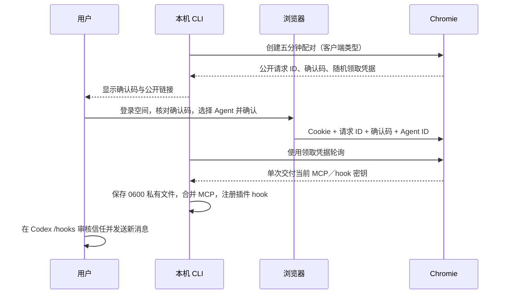

# CLI 统一接入

## 目标与边界

采用「安装一次 CLI → 浏览器确认接入 → CLI 合并 MCP 并安装 hook → 检查」的流程。用户已批准该方向，采用当前工作区内顺序实施；不增加依赖，不提交或发布仓库。

- 继续以空间隔离，不增加用户体系；空间密码只在 Web 登录时使用。
- 首批自动适配 Codex，其他客户端保留通用 MCP 与 stdin 采集协议。
- `chromie init` 是统一入口；`chromie hook install` 可单独修复采集安装，`chromie doctor` 检查连接。
- 浏览器确认采用五分钟的临时配对；URL 只带公开请求 ID，领取密钥使用 CLI 内存中的独立随机凭据。Web 必须登录并明确选择接入后确认，不自动授权；服务进程重启使配对失效。
- 每个配对只能领取一次；只允许本空间启用的 Agent，改密使已确认但未领取的配对失效。未登录、跨空间、跨站、过期、重复领取和错误领取凭据均拒绝。
- CLI 直接保存私有文件，不经模型输出；原有配置保留注释、其他服务和私有备份。同服务、同空间默认复用本机接入；`--reconnect` 重新选择。已有冲突先交互确认，非交互覆盖须显式 `--replace`，详见 [安装与 Shell 使用手册](Codex接入与使用.md)。
- CLI 安装 Codex 插件和 hook，但不代替用户确认 hook 信任，不声称安装等于真实 hook 已触发。
- 安装入口检测系统与架构，并校验构建清单中的 SHA-256。缺少对应平台产物时明确失败，不把服务器架构当成客户端架构。首版提供 POSIX 安装器，适配 macOS 与 Linux 的已构建目标；Windows 暂不声称可用。
- 密钥文件与本机全部权限代理的边界不变：不经过对话不代表能阻止同一账号的程序主动读取。

## 实施顺序

1. 复用既有私有文件与 TOML 合并，添加 CLI 初始化、独立 hook 安装和诊断入口；通过 Codex 官方命令安装插件。
2. 添加有界临时配对状态与鉴权 HTTP 合约，集成 Web 确认卡片。
3. 添加平台自动选择安装器与无凭据产物生成；Web 和 MCP 教程改为 CLI 优先。
4. 验证配置保留、重复安装、失败重试、配对权限和一次领取，以及真实 MCP 和虚构采集；浏览器检查接入页面。更新使用文档与实际验证记录。

## 验证要求

测试使用专用密钥，不输出或替换开发实例根私钥，不把真实接入密钥输出到日志。自动安装测试使用独立临时 `CODEX_HOME`，保留真实 Codex hook 信任。CLI 和安装器不触碰其他客户端的已有配置；下载必须成功校验后才替换旧程序。

## 配对合约

| 入口 | 鉴权与结果 |
| --- | --- |
| POST `/spaces/{space}/cli/pairings` | 无登录；只接受 codex／generic；返回公开 ID、确认码和独立领取凭据 |
| GET `/spaces/{space}/agents/pairings/{id}` | 本空间 Web Cookie；只返回公开确认信息 |
| POST `/spaces/{space}/agents/pairings/{id}` | 本空间 Web Cookie，正文为 agent_id 与 code；仅批准本空间已启用接入 |
| POST `/spaces/{space}/cli/pairings/{id}` | 领取凭据的 Bearer 头；pending 或一次性 ready，不接受 Cookie 替代 |

每空间每分钟最多发起 12 次，最多保留 16 个未过期请求；请求按五分钟失效，服务进程重启清空。所有响应 no-store，跨站 Origin 拒绝。Cookie 验证通过的密码版本随批准记录保留，领取时重新核对；密钥在实际领取时读取，不缓存旧版本。并行领取先消费请求，最多交付一次；网络中断须重新配对，不提供无期限重放。

CLI 通过 PATH 查找 Codex；macOS 找不到时兼容已安装 ChatGPT 应用内的 Codex CLI。Linux 需可运行的 Codex CLI。使用 Codex 官方插件命令，不直接编辑插件信任记录。插件包自身不含接入密钥，其脚本只持有私有配置路径。

## 实现与验收记录

2026-10-29 完成统一 CLI、Web 确认卡片、Codex hook 自动安装、通用接入初始化、安装器与平台产物生成。没有引入新依赖；没有提交或远程发布。

- 后端单元与实际服务回归共 36 项通过，包含 3 组新增配对测试：Cookie／跨空间／跨站／确认码／领取凭据、一次领取和并发竞争、改密／停用撤销、轮换后领取最新密钥，以及原生 CLI 初始化、保留原配置、重复安装刷新 Codex 缓存并实际执行缓存 hook 上传虚构消息。
- 前端 13 项 Rust 测试、45 项桥接测试通过；Web 发布构建通过。浏览器验证初始化指引、确认卡片默认不选接入和禁用确认按钮、320px 窄屏布局；未代替用户点击确认或信任真实 hook。
- 安装器 4 组测试通过，覆盖四种系统／架构的选择映射、缺少产物、校验失败和不可运行程序保留旧程序。四种映射使用虚构下载源模拟；另外在本机真实 HTTP 下载并安装 macOS ARM64 程序到临时 HOME，核对二进制一致。
- workspace 正式 lib／bin 的 check、Clippy、格式检查，以及 Wasm Clippy 通过。根私钥指纹保持一致；跟踪与非忽略文件未发现完整接入密钥。

当前开发服务提供 macOS ARM64 真实产物；其他三种 target 的安装映射已实现，但未在对应平台运行验证、也未提供产物。Windows／Alpine、远程 HTTPS 部署与真实日常会话 hook 触发仍须分别验收，不以模拟测试代替。

流程参考 [Lark CLI 安装向导](https://github.com/larksuite/cli/blob/main/scripts/install-wizard.js) 和 [平台安装脚本](https://github.com/larksuite/cli/blob/main/scripts/install.js)；Chromie 保留 MCP 执行记忆操作和 bin 执行采集的边界。

## hook 状态诊断

`chromie doctor` 的 MCP 连接结果和 hook 状态分开报告。`hook` 字段列出实际调用的 Codex CLI 路径／版本、CODEX_HOME、插件安装与启用、hooks 功能开关，以及来源目录／缓存目录的定义文件。可用 `--codex-dir` 明确指定要检查的客户端配置目录。通用接入不检查 Codex 插件。

`native_hook_verified: false` 表示尚未确认真实客户端触发，不等于未安装。即使测试上传成功，也不会将其改成真实 hook 已验证。插件已装但桌面 `/hooks` 为空时，先核对同一套 CODEX_HOME、Codex 功能开关和客户端重载状态；尚未安装或定义文件缺失时才提示重新安装。Codex 旧版 `plugin_hooks` 开关若仍有效且关闭会单独提示，已移除的开关不当成关闭。

安装或启用插件不代表信任 hook，信任仍由用户在 Codex 中审核。当前规则见 [Codex 官方 hooks 文档](https://developers.openai.com/codex/hooks)。诊断不回显私有配置或 hook 命令正文。

用户 MBP 的实际排查确认：插件已安装启用、hooks 开启时，重启桌面版并新建本地 Codex 对话后，空的 /hooks 列表能够发现 Chromie。安装提示统一为先刷新会话加载，再审核信任；可见不等于已触发采集，须再正常发送消息核对 Web 接收记录。
