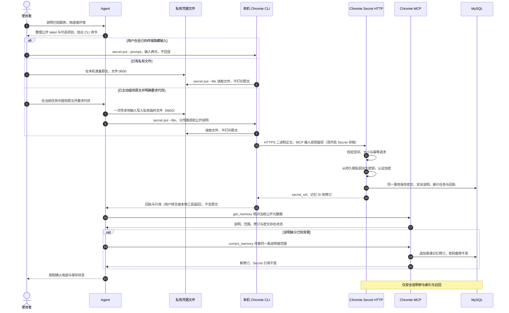
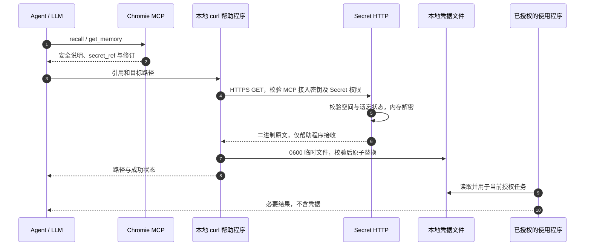

# Secret 记忆：存储、引用与本地取用

更新于 2026-10-29。已实现独立 HTTP 录入／取用／更新、服务端密文存储、MCP 引用召回与遗忘，以及内置 CLI 的隐藏输入与私有文件存取。HTTP 与 HTTPS 均支持，TLS 由部署和网关决定，不按网络位置限制。五个记忆工具保持原接口，get_setup_guide 按主题返回指南；用户可在独立 Web 浮层首次验证空间密码后查看文本原文，同一标签页免输 5 分钟，MCP 仍不输出原文。

## 推荐：CLI 录入与取用

Agent 先读取 `get_setup_guide(topic="secret")`，按返回的 `agent_id`、`access_path` 和 `secret_access_enabled` 核对接入权限；需要开启时由用户操作。尚未提供原文时，引导用户在自己的终端隐藏输入，或提供已有私有文件的绝对路径。已经主动提供原文且明确要求代存时，Agent 直接按指南在本地保存，不再要求重复录入或反复确认。

Agent 根据对话里已知的服务、用途和适用环境整理公开 `label`，已知项目通过 `--project` 关联；只知道服务名称时不编造账号、用途或环境，不把当前代码目录自动当作个人凭据所属项目。`label` 最多 256 个 UTF-8 字节，不能放密码、Token、敏感账号或带凭据的网址。用户无需手工填写背景表单，已经提供的原文不要求再次输入。

授权代存复用文件模式：通过一次性本地工具输入将已提供的原文写入系统私有临时目录（0700）中的载荷文件（0600），调用 `secret put --file`；文本密码显式指定 `--format text --kind password`，Token 使用 `api_token`。临时中转脚本也只放该目录，不写项目或长期脚本，不回显原文；完成后清理自己创建的中转文件。MCP 仍只接收公开元数据，原文不经 remember／correct_memory，服务端仍保存密文。用户已有文件不自动删除。

以下命令在 Bash 与 Nushell 中相同：

```shell
# 用户在自己的终端运行，隐藏输入并再次确认。
chromie secret put --label '服务密码' --prompt
# 对话中已明确服务、用途与项目时，Agent 带入这些公开信息。
chromie secret put --label '虚构 Aurora 测试环境部署凭据' --project aurora-demo --prompt
# 已有文件支持 JSON 凭据包或二进制数据。
chromie secret put --label '服务凭据' --file /私有目录/credential.json --contract /私有目录/contract.json
chromie secret get --ref secret://work/记忆UUID --revision 2 --out /私有目录/credential.bin
chromie secret update --ref secret://work/记忆UUID --revision 1 --file /私有目录/new.bin
chromie secret help
```

`--prompt` 保存输入本身，不自动包装 JSON。默认接入选择顺序为显式 `--config`、`CHROMIE_CLIENT_CONFIG`、已有接入环境、CLI 的 Codex 私有配置；通用接入可指定自己的 `--config` 绝对路径。输入文件需为 0600；取用会创建不存在的 0700 私有目录，已有目录权限不足时拒绝。默认不覆盖目标，确认可替换后添加 `--replace`。写操作返回／提示 `request_id`；重试复用同一个 `--request-id UUID`，更新还需当前 `--revision`。

CLI 不输出原文或服务端错误正文，不跟随重定向。旧安装缺少 secret 命令时重新运行接入页安装器升级；旧 Python 帮助程序保留兼容，日常流程不再依赖源码仓库。交互约定与验证见 [Secret 交互](Secret交互与Agent指引优化.md)。

格式契约与使用方式见 [Secret 格式契约设计](Secret格式契约设计.md)。`--prompt` 默认 text/password；API Key 可加 `--kind api_token`。原始文件不声明格式时保持 unknown，不按内容或扩展名猜测。当前 `get_memory` 返回契约及 revision，依赖契约自动取用时必须带该修订；版本不匹配时刷新元数据，不能绕过检查。JSON 字段和类型只来自允许公开的明确声明，不自动上传全部键。

给旧文本补格式、或本地检查未知 JSON，以下命令在 Bash 与 Nushell 中相同。命令里的修订须替换为刚读取的当前修订，所有文件路径为绝对路径：

```shell
chromie secret describe --ref secret://work/记忆UUID --revision 1 --format text --kind password
chromie secret describe --ref secret://work/记忆UUID --revision 1 --contract /私有目录/contract.json
chromie secret inspect --ref secret://work/记忆UUID --revision 1 --out /私有目录/structure.json
```

`describe` 仅更新经过服务端校验的公开契约和记忆修订，不改密文或载荷修订；仍要求 Secret 权限。`inspect` 只把路径和类型写入私有文件，不输出结构或字段值；结构清单需在本地审阅并选择允许公开的字段，不能直接发给模型。JSON 契约文件同样须为普通 0600 文件、版本 1、最多 4 KiB 与 16 个字段；字段示例见设计文档。

收到回执后，Agent 先用 `get_memory` 核对当前空间中的同一对象、公开说明、修订与密文存在状态。说明已足够就结束；缺少对话中已明确的背景时，用 `correct_memory` 补全同一条说明或项目范围，不再 `remember` 一条重复记录，不附原始事件来源。使用刚读到的修订，重复回执不重复写入，冲突先重新读取比较。整个补全过程不读取原文、不调用 Secret 原文更新入口；引用和密码载荷保持原样。补说明失败也不能要求用户重新录入已保存的密码。

## 根私钥不能扔

**`CHROMIE_KEY_FILE` 是实例根私钥，默认 `.local/chromie-key.pem`。必须持久保存并独立备份；丢失后数据库中的 Secret 无法恢复，不能用重新运行 `init-key` 修复。**

服务同时用这份 P-256 私钥签发 ES256 JWT，并从解析后的私钥字节经 HKDF-SHA256 派生 AES-256-GCM 密钥。派生密钥不单独落盘，重新加载原私钥即可重新派生。具体格式见 [加密与密钥持久化](Secret加密选型.md)。

- 首次创建新实例才执行 `init-key`，它拒绝覆盖已有文件。普通重启、部署和升级只读取原文件。
- 生产环境使用受控持久目录，配置绝对路径；不要把唯一副本留在临时容器或可清理的 checkout 目录。Unix 文件权限须为 `0600` 或更严格。
- 数据库和私钥分别做受保护的备份；不要提交 Git、贴进聊天，或把唯一私钥副本存进依赖它解密的 Secret 系统。
- 恢复时停止服务，保留当前文件与数据库，恢复相匹配的数据库备份和原私钥，核对权限与配置，再启动服务。启动会检查现存密文的 `key_id`，不匹配则拒绝启用，不自动换钥。
- 更换空间密码不改变 Secret 密文。当前没有自动根私钥轮换；换钥须保留旧钥，显式迁移全部密文，并考虑历史备份和 Web 登录失效。

## 数据边界

Secret 原文包括密码、API Key 或其他需再次读取的凭据。安全说明 `label`、项目范围和引用允许模型看到；敏感备注应放在原文里，不能夹带进说明或项目名。空间密码只保存 Argon2id 验证哈希，与可恢复的 Secret 密文用途不同。

| 数据 | 存储和用途 |
| --- | --- |
| 原文 | 本地受控文件、HTTPS 正文、服务端处理内存，以及用户重新验密后的 Web 临时浮层 |
| 密文 | 独立 `secrets` 表；包含格式版本、密钥编号、载荷修订、nonce 和认证标签 |
| 允许公开的说明 | 普通记忆修订，用于关键词索引、召回和看板 |
| 引用 | `secret://{空间短标识}/{记忆 UUID}`，定位对象，不授予访问权限 |
| 幂等摘要 | 用独立用途派生密钥计算 HMAC，不保存原文的裸哈希 |

通过 Secret 专用入口提交的原文不进入 MCP、普通记忆正文、原始事件、索引、任务、回执或日志。用户直接发给 Agent 的消息继续正常采集，不自动识别、脱敏或删除其中的内容；这与 Secret 专用存取是两条通路。普通 hooks 与 `remember` 不作为 Secret 的录入入口。

## 录入流程

Agent 可调用本地帮助程序，Chromie 命令参数只包含文件路径和安全元数据。尚未提供的原文不主动索取到聊天；已提供的授权代存允许一次性本地工具输入搬运原文，不回显、不进入公开元数据、MCP 参数或项目源码。是否允许代存依据当前授权，不按内网／公网区分。



## 在 Web 辨认 Secret

看板的“已保存记忆”下方会显示“含 1 项 Secret”等实际数量；它是记忆总数中的子集，不额外相加。计数只包含当前空间中未遗忘且仍保存密文的 Secret。最近记忆中的真实 Secret 带锁形 `Secret` 标签与“密文已保存”状态，普通说明中提到 Secret 或包含引用不会因此变成 Secret。

召回页同样显示独立标签，默认展示密文状态与可选中复制的 `secret://...` 引用，不需要展开调试详情。普通列表只展示安全说明与引用；用户也可点击眼睛，在独立浮层输入当前空间密码后显示文本原文。

“密文已保存”表示数据库存在该载荷，不代表页面执行过解密或完整性校验；缺少密文时显示“未发现密文”，旧服务未提供状态时显示“存储状态未提供”。页面不为状态展示读取或解密载荷内容，遗忘后相应数量与条目消失。

## 用户在 Web 查看原文

看板和召回卡片都有眼睛图标，点击后打开默认遮住原文的查看卡片。手动输入当前空间密码，再点眼睛或按 Enter 显示；错误密码可重试，不退出原有 Web 登录。不会预填浏览器记住的密码，也不使用 JWT 代替这次验密。

再次点眼睛会隐藏并清空原文；手动验密成功后，当前标签页仅在内存复用该密码固定 5 分钟，不续期，同空间再显示或查看其他 Secret 无需重输。关闭、同空间切页和后台隐藏保留剩余验证时间，但每次打开仍默认遮罩。显示满 60 秒或切到后台自动隐藏；关闭浮层、切页、退出空间或离开页面清空原文并取消在途请求，迟到响应不能恢复显示。验证到期、刷新、换空间或退出立即清除临时验证；每次 HTTP 读取仍校验密码，改密后的 401 也清除验证。仅支持有效 UTF-8 文本，二进制或不可显示控制字符继续使用本地文件取用。

原文只进入独立查看通道，不进入列表、召回调试、网址、存储或 MCP。不主动复制到剪贴板，也不承诺物理擦除浏览器内存。Agent 仍应走本地脚本，不通过页面读取或截图把原文送给模型。交互与验证见 [Secret 查看交互](空间与鉴权.md)。

## 本地帮助程序

仓库提供 [secret-curl.py](../examples/codex/secret-curl.py)，需要 Unix、Python 3.9+ 和 curl，无新增 Python 包。它负责空间／协议校验、密码传递、文件权限和失败保护，原文的 HTTP 传输仍由 curl 执行。

在启动 Agent 的本地环境中设置 `CHROMIE_URL`、`CHROMIE_SPACE`、`CHROMIE_MCP_KEY`（或 `CHROMIE_CLIENT_CONFIG` 指向 Web 下载的本机私有 JSON），以及帮助程序的绝对路径 `CHROMIE_SECRET_HELPER`。MCP 密钥通过本机私有配置或用户环境变量提供，并在 Web 接入页开启 Secret 存取权限，不贴进对话或工具参数。示意配置中的空间应替换成自己的空间：

Bash：

```bash
export CHROMIE_URL='https://你的域名'
export CHROMIE_SPACE='work'
export CHROMIE_SECRET_HELPER='/你的仓库绝对路径/examples/codex/secret-curl.py'
```

Nushell：

```nu
$env.CHROMIE_URL = "https://你的域名"
$env.CHROMIE_SPACE = "work"
$env.CHROMIE_SECRET_HELPER = "/你的仓库绝对路径/examples/codex/secret-curl.py"
```

帮助程序从环境或私有 JSON 读取 MCP 接入密钥，通过 stdin 的 curl 配置传递，不放进 curl 命令行。输入须为当前用户拥有的普通文件，拒绝符号链接，权限为 `0600` 或更严格；输出父目录须属于当前用户且为 `0700` 或更严格。请在仓库、采集及自动同步目录之外准备这些路径，原文大小为 1～60,000 字节。

创建 Secret，只把允许公开的用途写进说明：

Bash：

```bash
python3 "$CHROMIE_SECRET_HELPER" put '示例服务凭据' /私有目录/source.bin --project chromie
```

Nushell：

```nu
^python3 $env.CHROMIE_SECRET_HELPER put "示例服务凭据" "/私有目录/source.bin" --project chromie
```

返回 `secret_ref`、`memory_id`、`revision`、处理状态与 `request_id`，不返回原文。上传成功即可按引用取用；说明索引异步完成。网络失败需要重试时，复用首次返回的 `request_id`，通过 `--request-id UUID` 传入，避免重复创建。相同 ID 携带不同内容会冲突。

取用时将 MCP 召回到的完整引用交给帮助程序：

Bash：

```bash
python3 "$CHROMIE_SECRET_HELPER" get 'secret://work/记忆UUID' /私有目录/credential.bin
```

Nushell：

```nu
^python3 $env.CHROMIE_SECRET_HELPER get "secret://work/记忆UUID" "/私有目录/credential.bin"
```

响应直接写入私有临时文件，校验成功后原子替换目标，最终文件权限为 `0600`。鉴权、网络、响应类型或写入失败不会覆盖旧目标。程序只返回必要路径与状态；不要随后执行 `cat`、打印、截图或把文件正文交给模型。

更新凭据原文时，先通过 MCP `get_memory` 取得当前记忆修订，再传入该修订：

Bash：

```bash
python3 "$CHROMIE_SECRET_HELPER" update 'secret://work/记忆UUID' 3 /私有目录/new.bin
```

Nushell：

```nu
^python3 $env.CHROMIE_SECRET_HELPER update "secret://work/记忆UUID" 3 "/私有目录/new.bin"
```

更新同时推进记忆修订与独立载荷修订；公开说明和项目范围保留。版本冲突时先核对对象与当前修订。只改说明则用 MCP `correct_memory`，不需要重新加密原文。

本地文件可以长期保留复用，不强制用后删除。使用它的程序只返回必要执行结果，不回传凭据；向当前任务已授权的目标服务认证不等于允许向其他目的地外发。

## 召回与取用流程

`recall`、`get_memory` 和看板仅返回安全说明与引用。实际对象仍使用 UUID，空间使用短英文标识；空间改名后重新取得当前引用。加密绑定内部空间 ID，改名不改变解密结果。



MCP 五工具不增加原文参数或解密输出。`remember` 仍创建普通记忆；Secret 必须经独立 HTTP 创建，以免原文进入模型调用或对话来源。`correct_memory` 仅修改说明、项目和原因，不允许挂接原始对话来源。

## HTTP 合约

Agent Secret 请求逐次校验 MCP Bearer 密钥及接入的 Secret 存取开关；用户 Web 查看仍逐次校验 `X-Chromie-Password`，Web 登录 Cookie 不直接用于原文读取；接入管理会话可以创建密钥并授予 Agent 原文存取权限；禁止跨站请求，响应禁止缓存。服务没有应用层上传封包，远程 TLS 由部署的 HTTPS 代理提供。

| 方法与地址 | 输入与返回 |
| --- | --- |
| `POST /spaces/{slug}/secrets?label=...&request_id=...&project_key=...` | 原始二进制正文，原子创建密文和说明；`project_key` 可选 |
| `GET /spaces/{slug}/secrets/{memory_id}?expected_revision=...` | 二进制原文；预期修订可选，响应 `x-chromie-revision`，指定版本的 CLI 核对后才写文件 |
| `PUT /spaces/{slug}/secrets/{memory_id}?request_id=...&expected_revision=...` | 二进制新原文，要求当前记忆修订；保留说明与范围 |
| `PUT /spaces/{slug}/secrets/{memory_id}/contract` | JSON 正文 `request_id`、`expected_revision`、公开 `contract`，独立校验并补齐格式，不改密码载荷 |

POST／PUT 的 Content-Type 必须为 `application/octet-stream`；`label` 为 1～256 字节，项目标识为 1～128 字节，原文为 1～60,000 字节。`request_id` 使用 UUID，重试复用。说明和项目在查询参数中，只填写允许公开的元数据；生产代理也应避免记录完整请求 URI、密码头及正文。

原文 POST／PUT 可在 query 中添加 JSON 字符串 `contract`，与正文一起校验和提交。契约补齐专用入口则使用 `application/json`，不传原文。旧客户端省略契约时按既有契约验证新载荷；原契约未知则保持未知。原文、契约和说明的更改统一推进记忆修订；只有原文替换会推进加密内部载荷修订。遗忘时一并清除契约。

可以自行用 curl 按合约操作，但 GET 必须直接写私有文件，不能把响应原文输出给模型；接入密钥也不要直接放进 `-H` 命令行。推荐使用内置 CLI 的错误及文件保护；旧版仓库帮助程序保留兼容。

## 遗忘、备份与保护范围

MCP `forget_memory` 同时隐藏说明、清空在线密文并登记索引删除任务，后续 GET 失败。旧录入／更新请求重放不会复活内容。在线遗忘不清除备份、binlog、已下载文件或其他客户端副本；这些副本有独立的保留规则。

`0600` 不能阻止同等本机权限的 Agent 主动读取文件。本方案保证正常存取链路不主动把原文发给 LLM，未实现对任意 Agent 代码的强隔离，也未实现普通聊天和 hooks 的自动敏感信息过滤。

真实 MySQL／Qdrant 测试覆盖密文、鉴权、引用召回、更新、篡改、遗忘和 curl 文件存取。远程 HTTPS 部署演练、实际浏览器与任意 Agent 执行环境仍须分别验收；测试准备和运行方式见 [开发运行](开发运行.md)。

本机托管执行、按服务拆分、指南版本复用与取用审计见 [Secret 取用与审计](Secret取用与审计.md)。
