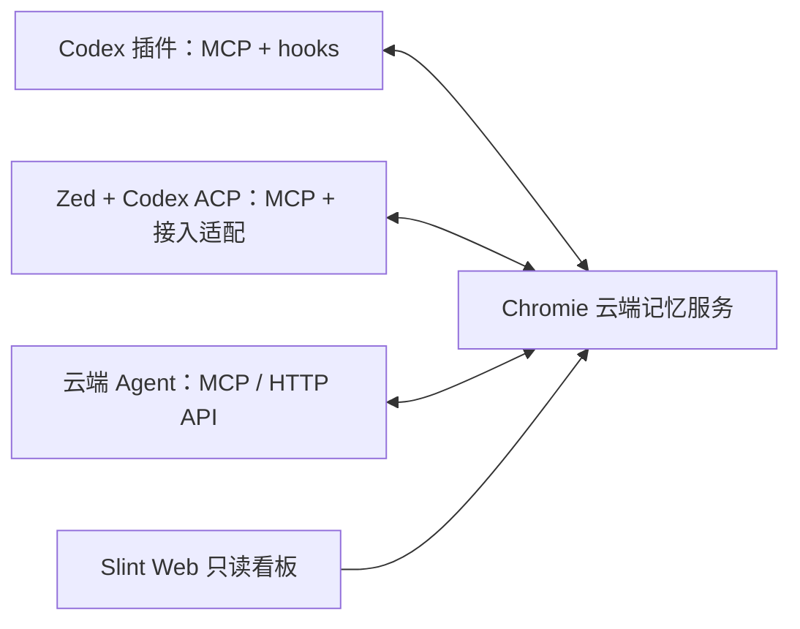

# 产品设计背景

本文保留产品目标与参考机制，未实现的设想不代表已交付；当前行为以 [项目说明](../README.md) 和 [使用手册](README.md) 为准，暂不按早期阶段清单扩展范围。

## 产品目标

Chromie 是跟随个人的记忆服务，鼓励个人私有化部署。一个实例可以建立工作、生活等记忆空间，仅保留空间这一层数据隔离；Codex、Zed + Codex ACP 及云端自动化 Agent 在各自选定的空间内接续有范围、有来源、可持续更新的记忆。

核心体验是：打开新窗口说起一件事，Agent 能接上相关背景，知道已经决定什么、验证过什么、还有什么没解决。个人偏好与经验随交流积累，项目特定的决定仍保留适用边界。

产品设计主要参考 **Signet 的使用流程**与 **Hindsight 的记忆理解机制**，再从 Graphiti、ZeroClaw、Mem0 吸收局部设计。

## 记忆空间与简单鉴权

空间用于隔离工作、生活等记忆，项目与话题在空间内组织，不引入用户、租户、成员或空间所有者模型。原始消息、具体记忆、个人背景、摘要、索引和后台任务都属于明确空间，不同空间之间不自动召回或归纳。

每个空间独立设置访问密码。MCP、采集 HTTP 与 hooks 从本地配置读取，逐次请求携带。Web 输入密码后签发 30 天 ES256 JWT，放在 HttpOnly Cookie 中；密码变更后旧登录态失效。不建设刷新令牌或设备管理。

Web 打开对应空间页面后输入密码，刷新或重开浏览器可通过持久 Cookie 恢复，主动退出清除本浏览器登录，记忆看板继续保持只读。页面默认只记住最近空间，不保存可由脚本读取的 JWT；用户可主动勾选“记住密码”，将最近一组已验证的空间与密码明文保存在此浏览器，按空间匹配预填，取消勾选清除。空间由接入配置绑定，切换空间建议开启新的 Agent 对话，避免已经注入的旧背景残留。具体机制与采集能力边界见 [空间与鉴权讨论稿](空间与鉴权.md)。

## 参考产品各自解决什么问题

| 产品 | 主要参考问题 | 对 Chromie 的角色 |
| --- | --- | --- |
| Signet | 记忆如何跟随不同 Agent，何时采集、何时提供背景 | 核心参照：接入与使用流程 |
| Hindsight | 如何把经历变成持续理解，记忆多了如何找到 | 核心参照：记忆组织、归纳与召回 |
| Graphiti | 事实变化后，如何同时回答“现在”和“以前” | 补充参照：时间、修订与来源 |
| ZeroClaw | 事实、事件、方法如何区分，存储与整理如何解耦 | 补充参照：记忆分类与职责边界 |
| Mem0 | 如何以少量操作完成个人记忆的存取 | 补充参照：简单接口与效果基线 |

## Signet：让记忆进入日常工作流程

### 会话生命周期接入

Signet 提供会话开始、用户提交消息、会话结束和上下文压缩相关 hooks，在这些时机提供背景或保存会话材料。它区分稳定的提示内容与动态记忆上下文；自动注入也有匹配和预算限制。[官方 hooks 文档](https://docs.signetai.sh/hooks/)

**值得吸收：**把“何时记、何时用”作为产品能力设计。新会话先得到少量稳定背景，收到具体任务后再补充相关话题和经验。接入端应显式声明能采集、能注入哪些事件，避免只有读写工具却被描述为全自动。

对 Chromie，Codex 桌面入口和 Zed + Codex ACP 都需要独立验证；其他产品列出“支持 Codex”，不能替代对这两个实际入口的验证。

### 原始证据与后台理解分开

Signet 当前先保存带来源的事件证据，Dreaming 再从中派生实体、断言及关联，以受校验、可审计的操作更新知识。其文档明确说明，旧的逐条抽取与决策 worker 已退役。[官方 Dreaming 文档](https://docs.signetai.sh/pipeline/extraction-decisions/)

**值得吸收：**让服务能重新理解历史，同时保留“当时实际说了什么”。模型提出合并、更正或归纳，程序负责检查来源、范围和允许的修改。后台出错后，应能找到受影响的派生内容并重新处理。

这里的证据保留是指整理过程不悄悄改写来源；用户删除仍需作用于原始材料及其派生内容。Chromie 首版普通原始消息不自动过期，直到主动遗忘或删除。

### 长会话连续性与记忆可检查

Signet 保留会话、检查点和压缩材料之间的来源关系；恢复的历史上下文也被明确视为背景，不构成当前授权。其界面支持查看记忆内容与来源。[会话连续性文档](https://docs.signetai.sh/pipeline/continuity-lineage/)、[管理界面文档](https://docs.signetai.sh/dashboard/)

**值得吸收：**长编码会话按增量和阶段保留必要信息，同一结论经过多次压缩仍属于同一条证据链。用户应能看见“为什么记住了这个”，并通过“这条错了”“只适用于这个项目”“忘掉这件事”修正系统理解。

Chromie 优先保留用户要求、阶段结论与关键验证证据。完整代码和长输出的留存范围仍按既有设计选择，不照搬其他产品的全量留存方式。

## Hindsight：从记住信息到持续理解

### 分开记住、找回和归纳

Hindsight 区分 `retain`、`recall`、`reflect`：接收并提取记忆、检索已有记忆，以及基于记忆进行更深入分析。[官方核心概念](https://github.com/vectorize-io/hindsight#core-concepts)

**值得吸收：**普通任务取回相关背景即可；“总结我最近反复遇到的问题”才需要跨经历分析。Chromie 可以分别管理这几类工作的延迟、成本和结果状态，避免每次取背景都重新生成一遍总结。

### 有证据支撑的经验归纳

Hindsight 的 observations 把相关事实整理成持续更新的认识，保留支撑材料，并在新证据到来后修正；未处理的新信息也会影响这些认识的新鲜度。[官方 observations 文档](https://hindsight.vectorize.io/developer/observations)

**值得吸收：**多次成功排查可以沉淀成方法，多次明确表达可以形成偏好。归纳结果仍要带适用条件、验证范围和来源，并允许被后续证据推翻。一次故障原因不能直接推广为所有类似故障的原因；同一摘要重复出现也不能增加独立证据数量。

### 持续更新的个人背景与话题状态

Hindsight 的 Mental Models 为预先指定的问题维护一份答案，在后台更新，读取时直接取得已有内容。它还记录来源、历史版本及新鲜度，相关新记忆尚未处理时，需要回查底层材料。[官方 Mental Models 文档](https://hindsight.vectorize.io/developer/mental-models)

**值得重点吸收：**为 Chromie 维护“我的工作习惯是什么”“这个话题已经决定什么、还有什么未解决”等持续更新的背景。新窗口先恢复话题当前状态，再补充具体事实和证据。

建议保留摘要的新鲜度与来源，更新时尽量只改受影响的部分。话题如何自动发现、拆分与合并，需要另行讨论；其他产品的固定问题机制不等于已经解决了自动话题组织。

### 多路召回与上下文预算

Hindsight 组合语义、关键词、关系与时间检索，再做结果融合、排序和预算裁剪。[官方召回文档](https://hindsight.vectorize.io/developer/retrieval)

**值得吸收：**精确标识符依靠关键词，换一种说法依靠语义，历史问题结合时间，间接关联按需补充。Chromie 应返回少量可用背景和可展开的来源，并允许没有可靠结果。关键词与语义组合已有设计方向；关系检索、重排模型等具体投入通过真实案例评估。

## 其他产品值得吸收的局部设计

### Graphiti：事实有有效时间，也有获知时间

Graphiti 用事件作为来源，维护带时间的事实及其失效历史；其关系模型分别记录创建、失效和事实有效时间。[官方项目说明](https://github.com/getzep/graphiti)、[时间字段源码](https://github.com/getzep/graphiti/blob/main/graphiti_core/edges.py)

**值得吸收：**“日志平台三月迁移，我五月才告诉 Agent”包含两个不同时间。问现在的入口应得到新地址，问迁移前的排查则可能需要旧地址。更正、现实发生变化和单纯补充信息也应区别处理；时间不明确时保留未知。

Chromie 先吸收时间与修订的表达，沿用既定持久化选型；完整图数据库的部署不是当前需求。

### ZeroClaw：记忆类型与整理策略分开

ZeroClaw 的接口区分事件、语义和流程记忆，语义记忆再细分偏好、事实、决策等；组织分类与记忆类型分开，底层 `Memory` 与负责整理的 `MemoryStrategy` 也分开。[官方接口源码](https://github.com/zeroclaw-labs/zeroclaw/blob/master/crates/zeroclaw-api/src/memory_traits.rs)

**值得吸收：**同一话题可以包含偏好、事实和方法，不应全部存成一种“聊天摘要”。存储负责可靠保存与查询，策略负责如何抽取和维护，便于后续改进整理模型。接口里的类型定义只证明表达能力，不能据此推断完整召回行为已经实现。

### Mem0：保持存取接口简单，建立效果基线

Mem0 强调个人记忆和用户、会话、Agent 等维度，并提供简洁的接入方式。[官方项目说明](https://github.com/mem0ai/mem0)

**值得吸收：**Agent 不需要理解内部所有层级才能读写记忆。Chromie 可以用简单存取方式跑同一组真实案例，再判断话题摘要、经验归纳和其他复杂机制是否改善了结果。

Chromie 以个人作为共享记忆的中心，Agent 和会话同时承担来源及访问边界信息。具体隔离模型需适配个人跨端复用的目标，不直接沿用按 Agent 分开的存储方式。

## 接入形态：Agent 如何使用 Chromie

接入采用“云端记忆服务 + 轻量客户端接入包 + Slint Web 看板”的整体形态。用户继续在 Codex、Zed 和云端 Agent 中工作，Chromie 的接入包负责把这些入口连接到选定的记忆空间。自动采集、整理与召回承担日常工作，尽量减少用户操作；下面的接口和生命周期细节仍需验证。

### 两条接入通道

| 通道 | 使用者 | 职责 |
| --- | --- | --- |
| 远程 MCP，例如 `/mcp` | Agent | 按需查找记忆、展开证据、记录明确结论，以及更正或遗忘 |
| HTTP API | 客户端 hooks、适配器和 Web 看板 | 接入层上报增量、获取待注入背景；看板只读取状态与观测数据 |

两条通道调用同一套记忆能力，使用相同的来源、范围和修订规则。MCP 工具不能自行监听整个对话；自动采集和自动补背景由客户端接入层触发。

面向 Agent 的首版已实现五个工具：`recall`、`get_memory`、`remember`、`correct_memory`、`forget_memory`。服务负责检索与来源管理，Agent 不必了解所有存储层级。参考项目、实际参数、写入可见性、更正与遗忘规则见 [MCP 接口设计](MCP接口设计.md)。

### MCP 版本与兼容边界

截至 2026-10-26，MCP 官方最新正式规范为 `2026-07-28`，引入无状态请求模型并移除旧初始化握手。[官方规范](https://modelcontextprotocol.io/specification/2026-07-28)

协议协商以官方 SDK 和客户端的实际能力为准，不根据规范发布日期推断客户端支持。应分别验证握手、工具发现与实际调用；当前接口见 [MCP 接口](MCP接口设计.md)。

先验证工具发现、工具调用和所需鉴权；扩展能力逐项确认。后台整理使用既定 Rust 服务内部任务，不依赖客户端支持长任务扩展。

### 自动接入如何工作

1. **开始会话**：获取少量稳定个人背景和匹配的项目背景。
2. **提交具体任务**：结合当前消息、项目及环境查询话题状态和相关经验，在预算内补充上下文。
3. **交流与执行期间**：捕获用户消息、阶段结论和可取得的关键验证结果，按增量上报。
4. **发生压缩或阶段结束**：保存必要的连续性信息，与原始事件关联并去重。
5. **需要深挖时**：Agent 通过 MCP 继续查询具体记忆和来源。

自动提供的内容标明历史来源、适用范围与新鲜度，不把历史指令提升为当前授权。接入层也要区分注入内容与真实新对话，避免把一次召回重新当成独立证据保存。

采集与后台整理分开：先可靠接收增量，再异步处理。拟为客户端设置短召回超时和可重试的上传机制；服务不可用时显示记忆状态，不阻塞正常对话。

### 各入口的具体形态

**Codex：私有插件作为主要接入包。**插件打包 MCP 配置、简短使用说明和 hooks，本地命令负责与云端通信。OpenAI 官方资料已提供远程 Streamable HTTP MCP，以及手工安装、携带生命周期 hooks 的桌面插件机制；插件 hooks 需要用户首次审阅和信任。[官方 MCP 文档](https://learn.chatgpt.com/docs/extend/mcp?surface=cli)、[插件打包文档](https://developers.openai.com/plugins/build/plugins)

官方 hooks 包含 `SessionStart`、`UserPromptSubmit`、`PostToolUse`、`PreCompact`、`PostCompact`、`Stop` 等事件，其中部分事件可向模型追加上下文。首版采用 `UserPromptSubmit` 的 `prompt` 采集新增用户文本，以及 `Stop` 可为空的 `last_assistant_message` 采集每轮最终回复。它们不自动补齐历史，中途追加、打断、恢复及桌面 / ACP 的覆盖范围仍需实测；会话记录路径可能为空，记录格式不是稳定接口，不作为唯一采集机制。[官方 hooks 文档](https://learn.chatgpt.com/docs/hooks)

首版同时保存空间、会话、轮次、事件、时间、角色和项目关联等来源信息；普通原始消息不自动过期。原始对话与正式记忆分开，当前 Agent 通过 `remember` 保存明确结论、阶段决定和关键验证结果。首版不自动采集全部工具参数和输出、附件正文、历史会话、内部思考过程或流式草稿；Secret 使用独立 HTTPS 录入与取用通道，只取消客户端上传前的额外公钥加密，服务端仍加密落库。完整采集边界见 [空间与鉴权](空间与鉴权.md)。

最新推进范围是先跑通 [最小可用版本](../README.md)：MySQL 保存原始证据与权威记忆，Qdrant BM25 默认只检索已保存记忆，必要时按引用展开来源。此前默认同时召回原始对话的方案收回，原始对话先作为后台材料与可追溯证据。采集不会自动替代 `remember`，也不把整个最终回复直接作为正式记忆。

增量提取和 embedding 已明确作为紧接最小版本的下一阶段，不纳入本次基础流程验收；复杂摘要、关系推理和重排继续按使用演进。当前先验证密码鉴权、写入、关键词召回、来源展开、更正与遗忘，分词、索引同步和删除传播要求不因阶段收敛而取消。前述自动接入与后台理解描述包含后续目标，不作为本次最小闭环全部实现的承诺。

**Zed + Codex ACP：先连接 MCP，再验证自动通道。**Zed 官方说明，外部 Agent 通常拥有自己的配置；Zed 的 MCP 配置可能通过 ACP 转发，Agent 也可能读取原生配置。需要确认用户实际使用的适配器走哪条路径，以及能否触发同一套 Codex hooks。能复用时共享接入逻辑，否则再评估薄 ACP 适配层，接收事件并补充背景。[Zed 官方配置边界](https://zed.dev/docs/ai/external-agents)

**云端自动化 Agent：MCP 或 HTTP API 直接接入。**能修改运行流程时，在任务开始、阶段完成和关键验证后调用服务；具体运行时是否支持 MCP、有哪些事件，需要按实际选用的框架核验。

仅完成 MCP 配置的入口标为“工具接入”；采集和注入都验证通过后，再标为“自动接入”。

### 客户端与 Web 看板

当前 Rust CLI 已提供 `capture`、`flush` 与采集暂停，通过环境绑定空间和密码，接入示例位于 `examples/codex`。自动安装配置、诊断界面和背景注入尚未实现，分发方式按实际使用演进。

Web 首版使用 Slint，Rust 编译到 Wasm，在浏览器中运行。Slint 官方支持这条路径，并将工具和看板列为适用场景；它采用 Canvas/WebGL 渲染，具体版本、浏览器运行和构建链路需后续验证。[Slint 官方 Web 文档](https://docs.slint.dev/latest/docs/slint/guide/platforms/web/)

Web 随实际使用逐步演进。当前分为看板与召回调试两个只读页面：看板呈现运行近况，召回调试供用户主动找回记忆并检查请求和结果。

| 看板区域 | 展示内容 | 目的 |
| --- | --- | --- |
| 状态与统计 | 空间是否可访问、记忆与消息数量、采集与同步时间、索引状态 | 确认服务和数据流转状态 |
| 最近记忆 | 最近 10 条记忆的预览、来源数量、适用范围和时间 | 确认已保存了什么 |
| 手动召回 | 关键词输入、召回正文、范围、修订与来源数量，及结果完整性提示 | 让人随时找回当前空间的记忆 |

最近记录按时间倒序显示，召回沿用服务排序，均有条数与长度上限。看板每 15 秒更新；召回调试仅手动执行，保留本次请求的结果、HTTP 状态、往返耗时与格式化 JSON，避免后台重跑覆盖现场。没有结果时显示空态，读取失败显示错误，不用虚构记录伪装正常。查询与调试结果只留在页面内存，不记录鉴权请求头或搜索历史；更正与遗忘在重新提交查询后体现。

看板与召回调试共用空间登录态，通过独立地址与导航切换。召回复用 MCP 的 `recall` 和空间鉴权，当前检索已保存的记忆，不默认搜索原始对话，不调用后台 LLM；边界见 [看板与召回调试分离](召回诊断信息.md)。复杂筛选、手工编辑、标签管理、图谱、趋势与任务队列操作按实际需要演进。纠正、遗忘等必要操作优先在日常对话中通过 Agent 完成。

整个第一版的主线仍是“自动记入 → 跨窗口找回 → 更正生效”。看板随着这条链路逐步接入真实数据，不要求用户另行维护。

每个入口配置目标空间及其密码，空间访问由服务端逐次校验，不由模型填写的字段决定。程序配置完成后，采集、整理和常规召回持续自动运行，无需用户反复点击同步或开始整理。

首个验证闭环是：一个入口接收用户提供的方法，另一个入口提出相关任务，方法和适用范围能自动出现；随后更正一次，后续召回使用新结论。验证时分别记录工具连接、自动采集和自动注入的结果。

## 吸收后，用户实际得到什么

以下是已有目标的具体化，以及本轮拟讨论的行为建议：

1. **教过一次，可以跨窗口使用。**在 A 中提供排查方法并验证后，B 描述相似问题时，能找到带条件和证据的方法。
2. **同一话题可以继续聊。**说“继续设计 Chromie”，能恢复云端部署、已定选型、讨论进展和未决问题。
3. **个人偏好与项目决定分得清。**“我习惯正式 Rust 目标禁止 unwrap”可以跨项目参考；“Chromie 使用 MySQL”仍是该项目的决定。
4. **新更正优先影响后续使用。**旧话题摘要尚未更新时，也不能继续把已被明确更正的信息作为当前结论。
5. **不需要一直塞入全部历史。**先给少量背景，任务明确后再检索，必要时展开原始证据；无法可靠匹配时只补问缺失的背景。
6. **能检查和修正自己的记忆。**知道它记住了什么、来自哪里、适用什么范围，并能更正或删除。

这组体验对应“个人背景 + 话题上下文 + 具体记忆 + 原始证据”的已有方向。后台归纳让这些内容不断更新，召回负责在当前任务中选择合适的部分。

## 本轮建议的取舍

优先吸收 Signet 的接入与连续性、Hindsight 的话题理解与召回，以及来源、范围、更正这些贯穿全流程的能力。先用真实对话验证收益，再决定是否增加复杂关系检索和更自主的后台推理。

后续后台模型整理建议从有边界的任务开始：提取、去重、对比冲突、刷新相关摘要。首版先保留原始证据与 Agent 明确提交的记忆，不依赖这些模型任务；索引同步、删除传播与失败重试仍需实现。更开放的 Dreaming 可以后续评估，其执行能力和成本都需要有明确边界。普通整理失败时，已经接收的材料仍应可追溯，派生内容应标明处理进度。

凭据独立保存、普通记忆保留引用的要求沿用既有方向。首版采集范围与普通原始消息不自动过期已确定；接入的实际覆盖能力，以及后续允许发送给整理模型的数据范围仍需确认。

## 下一轮最值得讨论的产品行为

| 讨论点 | 当前建议 | 需要明确的取舍 |
| --- | --- | --- |
| “已经记住”的含义 | 区分材料已接收、已整理、可作为当前结论使用 | 另一个设备刚接着提问时，如何覆盖尚未整理的新信息 |
| 话题如何持续存在 | 自动识别活跃话题，维护决策、进展和未决问题 | 拆分、合并、跨项目关联与归档的规则 |
| 后台能推导到什么程度 | 明确事实和验证结果可直接使用，归纳保留证据与不确定性 | 跨经历推导的新认识何时进入常规召回 |
| 后续看板如何演进 | 首版仅保留状态条、最近记忆和最近召回 | 根据实际使用中的问题决定新增内容 |

产品效果用同一组真实场景评估：该接上的背景是否接上、是否混入无关或过时信息、更正是否生效，以及消耗了多少时间和上下文。参考产品的公开评测分数不替代 Chromie 的实际验证。
