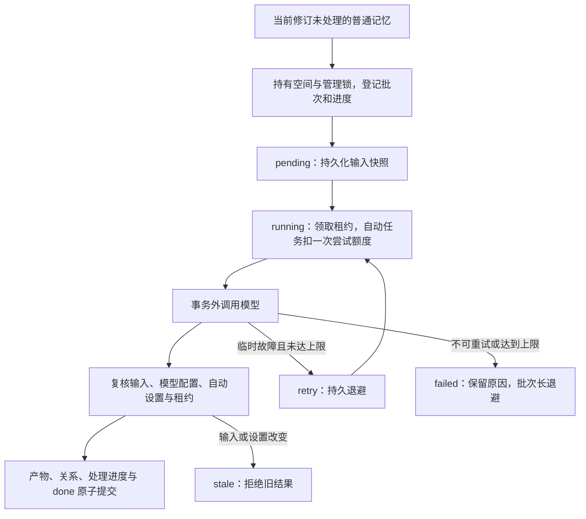
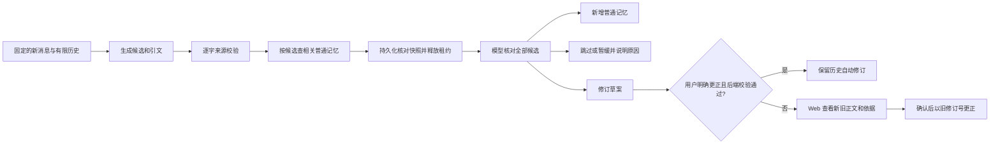

# 后台任务：自动整理与消息提炼

[返回 Wiki](README.md) · [任务表](数据模型.md#knowledge_jobs) · [模型调用](模型调用.md)

Rust 按持久进度调度普通记忆的主题整理，模型只返回有限 JSON，没有 ACP 或自主工具循环。原始对话可独立启用自动提炼及命名，也保留选择消息后手动提炼；两种任务共用领取、租约、校验和原子发布机制。

## 自动整理如何推进

启用文本模型与自动整理后，服务每两秒检查一次到期工作。调度只登记一个批次，实际调用由现有单项 Worker 执行；没有待处理资料不调用模型。默认每批最多 10 条、批次间隔 60 秒、UTC 每日最多 100 次自动处理尝试；在系统设置可修改或暂停。领取时在管理锁内计预算，重试和过期租约重新领取也占一次尝试；它是保守工作量上限，不等于供应商实际 HTTP 次数或 Token 账单。

`organization_items` 按空间＋记忆 ID 保存本次目标修订。先从较早更新的普通 note 选择工作，同项目范围成批；当前修订已完成就跳过，新建／更正自然进入下一轮。Secret 和 topic 都不作为待处理普通记忆，生成主题不会导致自我整理循环。调度从全实例最早到期资料开始，单个最终失败批次会退避，让其他资料继续。

遍历完毕后进入 idle。服务仍会轮询数据库检查是否出现新工作，但不会周期性地把已完成修订的正文重新发送给模型；重启、暂停再启用或更换文本整理模型也不清除成功进度。当前没有定期重审所有旧记忆的机制。更换 embedding 模型时的向量全量重建属于独立流程，不受整理进度影响。失败项按后文规则重试；已有主题可在处理新资料时作为有限对照上下文再次读取。

输入另外补读最多 54 个同范围主题，已有真实关系的主题优先，再补较早更新的入口；主题不挤占普通记忆配额。完整输入上限 128 KiB，超过时减少普通记忆条数，必要时减少对照主题，不截断正文。该范围是有限上下文，主题很多时仍可能遗漏对照，不能保证语义上的全局无重复。

成功且 0 产物也完成输入修订；有产物时，记忆、关系、索引任务、处理进度和任务 done 在同一事务提交。更正、配置变化、遗忘或过期租约都阻止旧输出发布。没有“先标记完成、稍后再写记忆”的窗口。

文本模型保存仅配置调用能力，不初始化或修改自动任务选择。两项自动任务默认关闭；用户在“后台记忆处理”勾选并保存后才生效，已有选择、运行参数与进度不会被保存或暂停模型覆盖。停用文本模型阻止整理发布；暂停自动整理只取消自动任务，不影响手动消息提炼、现有主题、检索或 Agent 主动记忆。

## 两种任务与兼容入口

| 来源 | kind | 输入 | 产物 |
| --- | --- | --- | --- |
| 后台自动调度 | `organize`、automatic=true | 同范围 note＋有限主题对照 | 简短主题入口与依据，或有限冲突说明 |
| 后台自动调度 | `extract`、automatic=true | 同一会话最多 10 条新事件＋有限历史与普通记忆 | 带真实来源的新 note、会话标题或空产物 |
| 采集消息页“提炼本页前 10 条消息” | `extract` | 选定 1～10 条事件＋有限既有记忆 | 带真实来源的新 note |
| 保留的 Web HTTP 指定范围接口 | `organize`、automatic=false | 显式最多 10 条记忆 | 相同主题发布协议，供受信任管理与调试 |

看板显示自动状态、当前修订已处理／总量／待处理／失败数量及最近结果，不再要求用户逐批点击。失败也包含在待处理总量中，两个数字不是互斥集合。预算上限按整个实例计算，记忆进度和任务列表按当前空间显示。

`/spaces/{space}/knowledge/jobs` 使用 Web Cookie 鉴权。请求仍包含 request_id、kind、可选 memory_ids／event_ids；幂等摘要保证相同请求重放不重复入队，不同参数使用同一 ID 会冲突。没有 MCP 整理命令。采集本身不直接调用模型；自动提炼开关开启后，调度器扫描未消费的消息。

## 领取与发布

一次领取产生独立 lease_owner，租期 180 秒，执行次数加一。多个服务进程通过同一管理锁防止重复自动入队与预算超支；运行中的模型并发计数仍是进程内额度，见 [模型调用](模型调用.md)。

等待共享额度结束后、发送 HTTP 前，还要重验模型配置、自动设置、输入与当前租约；已经暂停或撤销的等待者不发送资料，也不记一次模型 HTTP 用量。复核用短事务持有空间与管理锁，提交后视为已放行，HTTP在事务外执行；已放行或发送的请求不能从供应商撤回，结果仍受发布校验保护。

发布取得空间写锁、模型管理锁和任务行锁后，复核模型仍启用且 revision 一致、任务租约仍归当前执行者且未过期、所有输入记忆仍存活且修订一致、事件未遗忘。自动任务还验证自动设置启用且版本一致。旧执行者晚返回不能覆盖新租约或已暂停设置。

## 输出约束

organize 只能创建／更新本次读过的同范围 topic，至少一条 derived_from 依据，不能覆盖 note；局部更新保留没有读到的旧分支。extract 生成 note 并附真实选定事件来源；明确用户更正可按下文条件修订旧 note，不能改变范围或创建 Secret。记忆引用使用 links，事件来源使用 source_refs，两类 ID 不能混用。

每次最多 5 条产物、10 条冲突，正文最多 16000 UTF-8 字节。范围由真实依据／来源推导，不混合多个非空项目。冲突只保存输入 ID 与说明，不自行裁决、覆盖普通记忆或遗忘。类型、来源和修订校验保证结构边界，不能保证内容完整或事实正确。

任务恢复元数据只保留在数据库快照，发给模型的输入投影为 kind、memories、events；自动提炼另外携带当前标题、固定标志与本批新事件 ID。模型 JSON 正文、输入资料或 Key 不进入公开错误；失败只记录服务定义的安全错误说明。

## 失败、暂停与遗忘

临时网络、限流、供应商服务端、共享额度忙和暂时存储故障每任务最多领取四次（包括生成/核对阶段），退避 10、30、120 秒；鉴权错误直接失败。截断、过大输出、输出 JSON/结构和证据校验失败细分记录原因；自动批次先冷却30秒，重建任务时按上次实际工作条数减半，缩到单项仍失败则标为 blocked，配置改变或记忆新修订后才重试，不以24小时为周期原样重复。其他最终失败同修订同配置退避24小时。无须用户盯着点重试，但不能把永不成功的资料变成高频调用循环。

配置自动整理会撤销未完成的自动任务，清除其快照和租约，并释放 queued 进度；已完成修订保留。完成／终止后清空任务 payload，成功清理旧 error。遗忘会清空本空间任务副本与结果，撤销租约并释放排队进度；已遗忘对象不参与后续选择。

## 主题收敛与完整性

模型在同范围主题中优先复用入口，后端对同名已读主题也复用 ID。可用 `merge_from` 指定最多8个已完整读取的重叠主题，后端合并其关系并集，超过32条则拒绝合并。不同范围、普通记忆、未读主题或重复合并目标均拒绝。旧主题新增 `topic_alias` 修订，以单条普通引用指向保留入口；历史仍在。导航、看板和召回隐藏别名，直接读取返回 `redirect_to`，Web 跟随入口。不能制造循环；目标遗忘时旧别名同时清理，普通引用仍不扩大遗忘范围。已有主题上限是有界对照，不能保证全库语义去重。

生成和核对都要求正文可脱离原对话使用。核对可用 `content` 补齐真实来源中的背景或完整路径，不能编造；`quality_issue` 使候选暂缓。明确残缺的安装地址也由后端阻断，不将省略路径当作可执行完整流程。无需所有记忆填写机器信息或固定模板。

更正成功后，旧修订上的待确认方案标为 superseded，不能确认覆盖新内容。读取/召回返回当前 `pending_revisions` 和安全提示，不把未确认建议当作当前事实。

失败结果的 `diagnostic` 仅包含阶段、快照字节数、工作条数、静态错误码、尝试次数及是否自动重试，不保存原始模型响应或输入正文。

## 实现与验证

[调度与进度](../src/store/organization.rs)、[快照与入队](../src/store/knowledge_jobs.rs)、[Worker](../src/store/knowledge_worker.rs)、[模型提示词](../src/text_model_instructions.md)、[Web 控制器](../web/src/text_browser.rs)。[产品回归](../tests/knowledge_jobs.rs)验证批量历史、空产物、预算／跨日、重启、更正、主题对照、失败让路、暂停恢复及既有原子发布；真实模型质量观察单独记录，不能用模拟响应替代。

## 对话增量提炼与标题

`extraction_enabled` 与普通记忆整理开关独立，默认关闭；开启前页面明确说明各空间历史及新增原始对话将发送到模型。两个业务共用间隔、每批上限和每日预算，`last_kind` 让有工作时交替调度；全实例仍只有一个未结束的自动批次。

会话身份是空间＋Agent ID（旧数据允许为空）＋不变的 session_id，内部以 JSON 元组的 SHA-256 为 metadata 键，避免空来源唯一索引的 NULL 陷阱。`extraction_items` 逐事件记录 queued/done/failed/blocked；缺少进度即未处理。调度按服务接收时间筛选至少 30 秒前收到的事件，再在同会话按消息发生时间固定一批；消息时间不是消费游标，因此很早的离线补传也不会漏掉。处理期间的新消息不在快照中，下批再处理。

生成阶段在本批新事件之外最多读4条此前同会话消息，输入最多128KiB；不再把最近6条普通记忆当作去重依据。先形成最多5条候选，携带正文、fact/decision/preference/method类别、检索词与逐字来源引文。每条至少引用一条新增事件，偏好必须有用户原话；引文不匹配的候选强制暂缓。来源/引文超量的单条候选也暂缓，只保留有界展示材料，不按截断后的证据发布；其余合格候选和消费进度继续，避免模型多摘一段引文使整批丢失。模型不应将抱怨/否定理解成持久偏好，或把助手建议升级为用户决定。

候选生成后逐条用现有关键词/可选语义召回找相关普通note，补充最近500条的词面查找；索引命中的旧note也会读取，窗口不限制索引命中。每候选最多取4条、合并最多15条，完整核对快照最多256KiB，超限只减完整条目。后台查找不统计Agent/Web热度，不读取Secret原文；无embedding时仍走关键词，范围有限会标记retrieval_partial。相关当前修订、候选和原始证据持久化后释放租约，下一次领取执行核对；重启可接续，不重复生成候选。

核对覆盖全部候选：create自动新增，propose_revision提出旧note完整修订方案，skip去重/丢弃低价值过程，defer保留歧义或证据不足的原因。修订必须指向已读旧note的确切修订，且有用户证据；核对阶段可从固定events补充最多4段逐字引文（例如生成阶段漏掉的用户授权），先校验正文匹配、项目范围及来源上限，不能编造证据；对于明确用户更正，模型可提供 explicit_change 用户逐字引文；后端校验新增范围、角色、同一目标唯一方案、已读修订与范围，以及引文时间不早于旧来源，且来源并集不超过16条后自动修订，保留旧正文和关系。内部 background_revision 写回执区分后台发布与人工确认。除有内部后台回执且有来源的修订外，更正证据还须不早于当前修订创建时间，防止保留旧来源的人工新决定被历史消息覆盖；不靠 change_reason 文案判断。助手报告状态变化、歧义或时序不足仍待确认。Web查看依据、旧正文和建议正文后确认，使用现有更正事务并保留旧来源/引用，重复确认返回同一回执，旧修订变化时拒绝。暂缓不是待处理循环，不会定时重跑；后续新消息或主动提炼可产生新候选。

生成阶段返回 `conversation_title`；没有明确事项可为null并保留原名，浏览仍回退消息摘要。继续同一事项保留标题，明确转向新主要事项才更新，临时插话不改。无 note 产物也会推进消息并处理标题。模型产物、标题历史、事件 done 和任务 done 同事务提交；固定标题、标题修订已变化或已有更新的已消费消息时只跳过模型命名，仍正常消费这批消息。恢复自动后保持当前标题，等下一批新增消息再判断。未生成标题时，浏览列表显示首条用户消息的短摘录。

会话页显示标题、原始 ID、来源与已处理／总消息数；提供固定标题、恢复自动、最近 10 次标题历史。历史完整保存在数据库，界面只取最近 10 条，不把标题作为独立长期记忆。遗忘会清空本空间所有派生标题及历史、取消在途快照并释放排队事件，避免残留被遗忘事实；已完成事件进度不清除，不让遗忘触发历史重跑。

实现：[增量调度](../src/store/extraction.rs)、[标题](../src/store/conversations.rs)、[会话浏览](../src/messages.rs)。测试覆盖迟到消息、固定快照、零产物、标题历史／固定、暂停、重试、遗忘、预算及 Agent 隔离；模型质量观察另见真实模型验证。

迟到旧批次仍可提炼，但若会话已有更晚发生且已完成的消息，不用旧批次响应覆盖当前标题。单条消息因 JSON 转义后无法容纳时，记录失败并冷却 24 小时，不调用模型，不阻塞其他会话或普通整理；更换文本模型配置可提前重试。

## 提炼结果与修订确认

`POST /spaces/{space}/knowledge/review` 按job_id读取完整候选决定；轮询jobs仅返回计数和状态，不重复发送大正文。`POST /spaces/{space}/knowledge/apply-revision`接收job_id/candidate_index，限定Web Cookie身份；MCP密钥不允许确认。空间锁→任务锁→当前修订检查→correct事务→回执入任务结果，同事务提交。来源遗忘、空间不符、目标变成Secret或旧revision改变均拒绝。保留旧来源加新来源超过16条时，提示人工整理而非静默丢弃依据。遗忘仍清空全空间任务payload/result，涵盖所有候选与引文。

默认输出预算16384 Token，模型HTTP超时120秒，阶段租约180秒；已有明确配置不静默覆盖。每阶段一次模型调用，生成后的相关检索可能另外调用embedding；共享同名模型并发与按天用量。自动每日预算计算每阶段领取次数，空候选只需生成阶段。不承诺全部历史语义去重、偏好理解零误差或自动裁决所有冲突。

16384是单次调用的最大生成量，不是模型上下文窗口，生成和核对各有独立预算。是否包含推理消耗取决于供应商协议；不能从旧的统一`model_response`错误反推当时预算、实际Token或具体结构问题。输出截断和JSON／Schema错误分开处理。模型响应未通过校验时，服务只记录固定阶段、错误码、配置预算、供应商报告的输入／输出／推理Token计数和正文长度，不记录输入、正文、推理原文或任意上游错误文本；缺失计数保持未知，不当成0。

每次调用只带当前任务的提示词：生成、核对、主题整理、维护、探针分别选择协议，安全边界共用。核对不要求重抄未变化的候选正文和已有证据，降低冗余输出。普通技术答疑不自动沉淀成百科记忆；明确要求长期保存，或形成实际系统决策和排障经验时可保留。一次性评价须能辨别对象与事项，缺主体时可空产出或暂缓；不强制机器／项目字段。这是模型质量指引，需实际使用检验，不代替证据校验。

Chromie是存储平台，不能被默认补成资料中的业务主体。模型须区分来源里的系统名称与project_key／空间名；描述性主体足够时保留原文范围，不为补全上下文猜专有名称。核对阶段再次检查并纠正无依据的主体归属，来源不够则暂缓。事实时间依据消息发生时间或正文明确时间，不能用后台处理时间替代。

主题输入附`link_capacity`（used／remaining／limit），说明既有入口容量。后台只折叠完全相同的引用，同目标与关系的冲突修订拒绝；补回未读分支后再次校验32条总上限。超限为可触发缩批的`model_evidence_invalid`，而非直到写入才报通用参数错误；不会为腾位置截掉旧入口。满容量时保留原主题并按真实事项建立细分入口，不能改名制造重复目录。

实现：[两阶段提炼](../src/store/extraction_pipeline.rs)、[相关记忆](../src/store/extraction_related.rs)、[确认修订](../src/store/extraction_proposals.rs)、[页面结果](../web/src/extraction_browser.rs)。

提炼阶段概览：

## 独立低频维护（maintain）

与按新修订增量推进的 organize 分开，`maintain` 不依赖新记忆：从普通 note 与 topic 中，按上次覆盖时间轮转检查。`maintenance_enabled` 独立开关默认关闭，`maintenance_interval_hours` 默认24、允许1～168；三类自动任务共用批次间隔、同名模型并发、持久租约和每日尝试预算，按上次任务类型轮转。

每批最多10条工作记忆，可携带同项目/空间通用范围的既有主题上下文；完整快照最多128KiB，超限减条目，不截断正文。每条工作 note 优先读取最新问题报告，再读取最新观察，合计最多20条真实使用报告，仅包含该版本的公开原因、结果、原召回ID、Agent身份与时间。原文、Secret 和工具执行输出不进入维护。没有到期项就不调用模型。

`maintenance_items` 固定当前工作修订、排队任务、请求时间和完成覆盖边界。完成覆盖使用任务入队时间，不用响应时刻：执行期间收到的问题会保留 pending，下一批继续检查；维护自身更新的主题同步登记新修订，避免自我循环。成功项在周期内跳过；当前修订变化或新的内容过时/环境受限报告可提前唤起。暂停保留成功进度；结构错误缩小下一批，单项阻断，配置变化或新反馈可解除；网络等临时错误复用既有退避，耗尽后冷却24小时。未使用不代表无价值，不按冷门自动归档。

主题更新/合并沿用 organize 的范围、修订和引用校验，旧主题留别名与历史。普通记忆只产生 `revisions` 待确认方案：目标必须是已完整读取的 note，反馈必须属于同一目标修订、为 content_outdated/environment_blocked 且有原因；成功或未验证报告不能作为改事实的证据。Agent 报告不是独立事实校验，环境受限不能固化成方法永久失效。确认接口同时重读反馈、原 Agent、当前目标、遗忘状态，随后复用原更正事务；冲突拒绝、历史和关联保留。

Web 把“消息提炼结果”和“记忆维护”分开，后者展示更新、合并去向、冲突与待确认正文。`knowledge_jobs` 的 maintenance 返回本周期覆盖、待处理和失败计数；全部完成只表示已核对，到下一周期再次轮转，不保证模型一定修改或合并。

实现：[调度与进度](../src/store/maintenance.rs)、[使用证据](../src/store/use_reports.rs)、[维护草案](../src/store/maintenance_proposals.rs)。
