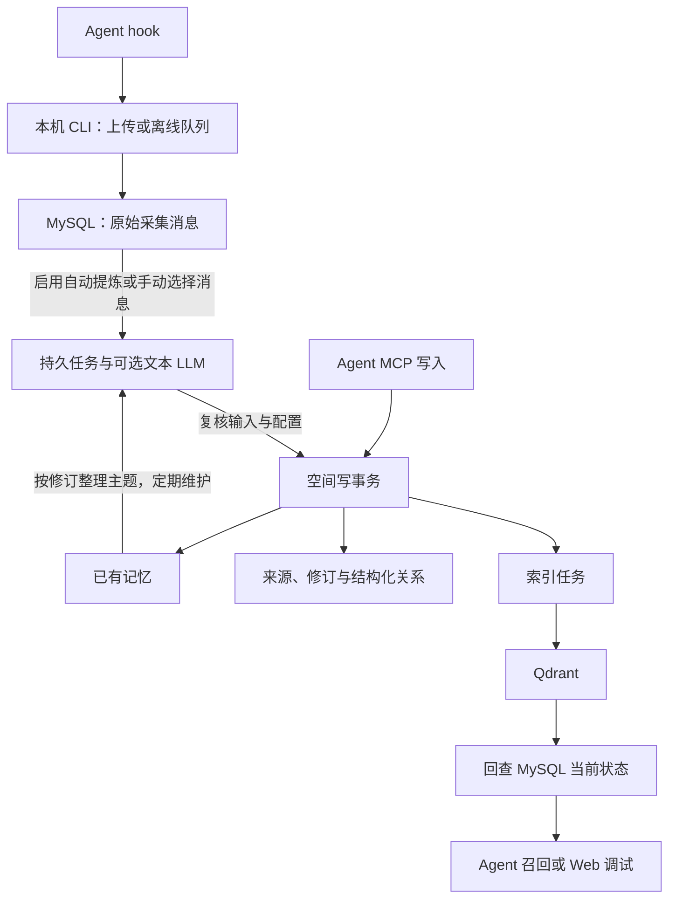

# 架构与数据流

[返回 Wiki](README.md) · [数据模型](数据模型.md)

Chromie 是个人私有化部署的跨对话记忆服务，空间是唯一数据隔离层。正文组织由 Agent 判断，后端维护身份、修订、来源、引用、鉴权和一致性。

## 运行组件

| 组件 | 职责 | 主要入口 |
| --- | --- | --- |
| `chromie-server` | Axum HTTP、MCP、鉴权、数据库与后台任务 | [服务启动](../src/server.rs)、[Store](../src/store/mod.rs) |
| `chromie` | 本机配对、安装 hook、采集上传、离线补传、Secret 取用与 Skill 导出 | [CLI](../src/main.rs)、[接入](../src/cli_setup.rs) |
| Web | Slint／Rust／Wasm，使用登录 Cookie 调用同源接口 | [Web](../web/src/lib.rs)、[浏览器桥接](../web/bootstrap.js) |
| MySQL 8.4 | 空间、记忆、修订、凭据密文、来源、任务及统计的权威存储 | [数据模型](数据模型.md) |
| Qdrant | 正式记忆的关键词索引和可选向量索引 | [检索实现](../src/search.rs) |

发布时客户端和服务端使用各自的 Cargo feature；Web 为独立 workspace 包。CLI 不需要本机运行 MySQL 或 Qdrant，详见 [技术选型](../docs/技术选型.md)。

## 三条数据链路

hook 保存原始事件。开启自动提炼后，后台按会话处理尚未消费的消息，核对来源后发布记忆。主题整理和低频维护可分别开启。Agent 主动写入、手动或自动提炼生成的正式记忆都通过同一条索引链路进入召回。

引用关系通过 MySQL 单独查询。当前 recall 没有自动关系遍历、图排名或多跳扩展；Agent 可以先搜索，再按需沿引用阅读。

## 写入与索引一致性

空间写操作通过 `Store::begin` 对 `spaces` 行加排他锁，当前选择同空间串行写。正文、来源、关系、幂等回执和索引任务在同一事务提交。成功回执表示按 ID 可读，`index_pending` 表示索引仍待处理。

`outbox_tasks` 按记忆合并到最新目标修订，embedding 使用独立代际任务。模型 HTTP 在事务外执行；当前关键词与向量的 Qdrant 发布操作仍位于取得空间锁后的事务内，串行保护发布顺序，也意味着索引网络延迟可能阻塞同空间写入。

MySQL 与 Qdrant 没有跨库原子提交，恢复依靠任务幂等重放与权威状态回查。召回在返回前重新检查空间、当前修订和遗忘状态，索引中的旧命中不能冒充新正文。

后台循环在服务进程内运行：关键词索引、embedding 和文本整理分别处理自己的持久任务，不增加 Redis 或额外队列服务。文本整理的领取、租约与提交细节见 [后台任务](后台任务.md)。

## 权限边界

Web 使用空间密码登录后的 HttpOnly JWT Cookie；模型管理只允许实例管理空间。MCP 与采集分别使用每 Agent 的独立 Bearer 密钥，Agent 身份由鉴权结果确定。项目范围是空间内筛选，不是另一层安全隔离。

Secret 普通读取只返回公开说明、格式契约和引用；原文由专用 HTTP／CLI 通道处理。实例根私钥须持久保存并单独备份，不能在升级或故障恢复时重新生成。完整规则见 [空间与鉴权](../docs/空间与鉴权.md)、[Secret 记忆](../docs/Secret记忆.md)。

## 代码与验证入口

写入与遗忘见 [write.rs](../src/store/write.rs)，索引发布见 [worker.rs](../src/store/worker.rs)和 [embedding_batch_worker.rs](../src/store/embedding_batch_worker.rs)，召回过滤见 [recall.rs](../src/store/recall.rs)，空间与 HTTP 鉴权见 [web_auth.rs](../src/web_auth.rs)。基本工作流、空间隔离、幂等、采集与 MCP 的集成验证见 [workflow.rs](../tests/workflow.rs)。涉及环境和凭据的测试必须使用隔离库，不默认连接个人或生产数据。
